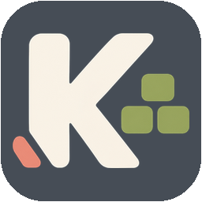
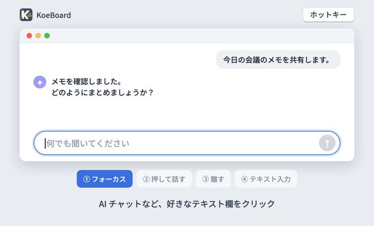
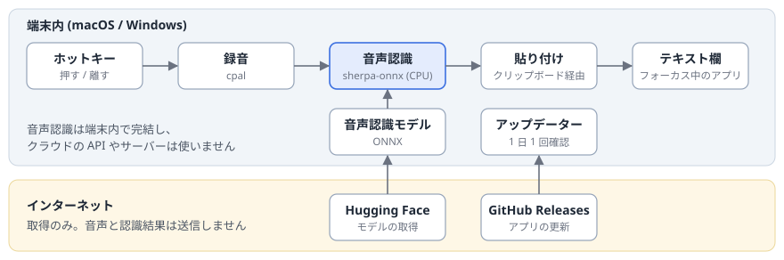

<p align="center">
  
</p>

<h1 align="center">KoeBoard</h1>

<p align="center">
  macOS / Windows に常駐する、Rust 製・ローカル完結の音声入力アプリ
</p>

<p align="center">
  
</p>

ホットキーを押して話すと、フォーカス中のテキスト欄に文字が入ります。GPU は不要で、音声は端末の外へ送信されません。[Handy](https://github.com/cjpais/Handy) にインスパイアされて作りました。

## 使い方

| 操作 | 動作 |
|---|---|
| ホットキーを押している間だけ話し、離す | 録音して入力 |

録音中は画面下部に、話している状態を知らせる小さな表示(音声フィードバックパネル)が出て、声の大きさに合わせて波形が動きます。認識が終わるとパネルに結果の全文を折り返して表示し、元のテキスト欄に貼り付けます。パネルはフォーカスを奪いません。トレイのマイクアイコンは、録音中が赤、認識中が橙になります。

## アーキテクチャ

Rust で書かれており、主に次のライブラリを使っています。

- [sherpa-onnx](https://github.com/k2-fsa/sherpa-onnx): ONNX 形式のモデルを使い、端末内で音声認識を行うライブラリ
- [tao](https://github.com/tauri-apps/tao): macOS / Windows 共通でウィンドウやイベントを扱うライブラリ
- [wry](https://github.com/tauri-apps/wry): OS 標準の WebView で画面を表示するライブラリ(設定画面に使用)

音声認識を含む入力の処理はすべて端末内で完結し、クラウドの音声認識 API やサーバーは使いません。インターネットに接続するのは、モデルのダウンロードとアプリの更新のときだけです。どちらも取得のみで、音声や認識結果は送信しません。

<p align="center">
  
</p>

| モジュール | 役割 |
|---|---|
| `src/app.rs` / `src/gesture.rs` | イベントループ、トレイ、ホットキーの押下と解放の判定 |
| `src/audio.rs` | マイクからの録音と、認識前の音声の下処理 |
| `src/engine.rs` | モデルの読み込みと解放、音声認識(専用のワーカースレッドで実行) |
| `src/inject.rs` | クリップボード経由の貼り付けと、クリップボードの復元 |
| `src/overlay.rs` | フォーカスを奪わない音声フィードバックパネル |
| `src/settings.rs` / `src/settings.html` | WebView の設定画面 |
| `src/models.rs` | モデルの一覧、ダウンロード、ハッシュ検証 |
| `src/updater.rs` | GitHub Releases からの自己更新 |

## インストール

[Releases ページ](https://github.com/jojonki/KoeBoard/releases/latest)から、お使いの環境のファイルをダウンロードしてください。

**macOS(Apple Silicon)**

`KoeBoard-macos-arm64.zip` を展開し、`KoeBoard.app` を `/Applications` などに置いて起動します。開発元を確認できないという警告で開けない場合は、システム設定 → プライバシーとセキュリティ の「このまま開く」から起動してください。

初回に次の 2 つの権限を許可してください。

- **マイク**: 初回の録音時に確認が出ます。
- **アクセシビリティ**: システム設定 → プライバシーとセキュリティ → アクセシビリティ。貼り付けに必要です。未許可の場合、認識結果はクリップボードに入ります。

**Windows**

`koeboard-windows-x64.zip` を展開して `koeboard.exe` を実行します。同じフォルダの DLL は移動しないでください。設定画面には WebView2 ランタイムが必要です(Windows 11 には標準で入っています)。

**モデルのダウンロード**

モデルは自動ではダウンロードしません。初回起動時に設定画面の **Model** タブが開くので、ライセンスを確認して、使うモデルをダウンロードしてください。モデルが入るまでは、ホットキーを押しても録音せずこの画面を開きます。

## ソースからビルド

自分でビルドすることもできます。Rust(stable)が必要です。初回ビルド時に sherpa-onnx のビルド済みライブラリを取得します。

**macOS 版**

```sh
./scripts/bundle-macos.sh
open dist/KoeBoard.app
```

自己署名のため、再ビルドすると権限の許可をやり直す必要があることがあります。

**Windows 版(macOS でクロスビルド)**

```sh
brew install mingw-w64
rustup target add x86_64-pc-windows-gnu
./scripts/package-windows.sh
```

## モデル

設定画面の Model タブで切り替えられます。現在は日本語モデルを用意しています。次の表は Apple M6 の CPU で、合成音声を使って測定した値です。

| モデル | 容量 | 3.8 秒の音声 | 20 秒の音声 | メモリ | 句読点 |
|---|---|---|---|---|---|
| Haas-ja v1.0 量子化版(既定) | 約 480MB | 約 150〜200ms | 約 1 秒 | 約 0.8GB | あり |
| ReazonSpeech k2 v2 int8 | 約 160MB | 約 55ms | 約 0.2 秒 | 約 0.6GB | なし |

ライセンスの詳細は [THIRD_PARTY.md](THIRD_PARTY.md) を参照してください。

## 設定

トレイの **Settings...** から、タブ付きの設定画面(General / Model / Layout / Updates)で変更できます。ほとんどの項目はすぐに反映されます。設定は次のファイルに保存され、直接編集もできます。場所は macOS が `~/Library/Application Support/KoeBoard/config.toml`、Windows が `%APPDATA%\KoeBoard\config.toml` です。

| キー | 既定 | 説明 |
|---|---|---|
| `hotkey` | `control+shift+KeyK` | 例: `control+alt+Space` |
| `model` | Haas | `koeboard --models` の ID |
| `threads` | `0` | 0 は論理 CPU の半分(上限 6) |
| `idle_unload_minutes` | `10` | 未使用時にモデルをメモリから解放するまでの分数。0 で常に保持 |
| `keep_mic_open` | `false` | マイクを開いたままにして録音開始を速くする |
| `microphone` | 空 | 入力デバイスの ID。空はシステムの既定。設定画面の General タブで選べます |
| `max_record_seconds` | `300` | 録音の自動停止までの秒数 |
| `restore_clipboard` | `true` | 貼り付け後にクリップボードを元に戻す |
| `enter_mode` | `off` | 実験的機能。入力後の Enter。`off`、`always`(常に押す)、`keyword`(`enter_keyword` で話し終えたときだけ押す)。設定画面の General タブで選べます |
| `enter_keyword` | `オーバー` | `keyword` のときの終了語。認識結果の末尾から取り除き、Enter に置き換えます。末尾の句読点は無視します。Enter を押すと、パネルに小さな ⏎ が一瞬表示されます |
| `overlay` | `true` | 音声フィードバックパネルの表示 |

### 音声フィードバックパネルの見た目(`[panel]`)

録音中の波形と認識結果を画面に表示する、小さなウィンドウの設定です。録音を開始するたびに読み直すので、再起動せずに調整できます。色は `#RRGGBB` です。サイズはディスプレイの拡大率に合わせて自動で拡大します。4K を 100% で使う場合のように OS が拡大しない大きな画面では、解像度に応じてパネル全体をさらに拡大します(4K で 1.5 倍)。

| キー | 既定 | 説明 |
|---|---|---|
| `position` | `bottom` | `bottom`、`top`、`center` |
| `margin` | `160.0` | 画面端からの距離。`center` のときは下方向のずれ |
| `offset_x` | `0.0` | 左右のずれ(右が正) |
| `width` / `height` | `156.0` / `36.0` | パネルの幅と高さ |
| `max_text_width` | `460.0` | 認識結果を表示するときの最大幅 |
| `text_size` | `13.0` | 文字の大きさ |
| `opacity` | `0.88` | 不透明度 |
| `background` | `#15161B` | 背景色 |
| `level_color` / `level_color_end` | `#6FE3FF` / `#B69CFF` | 録音中の波形のグラデーション。設定画面の Layout タブでプリセットからも選べます |
| `busy_color` | `#9AA0B5` | 認識中のインジケーターの色 |
| `text_color` | `#F2F2F7` | 文字の色 |

## アップデート

GitHub Releases の最新版を1日1回ほど確認し(通信先は GitHub のみで、音声や認識テキストは送りません)、新しい版があるとトレイメニューとパネルでお知らせします。設定画面の **Updates** タブ、またはトレイの **Check for Updates...** からインストールできます。自動確認は同じタブ、または `config.toml` の `auto_update` でオフにできます。macOS では `KoeBoard.app` を書き込み可能な場所(`/Applications` など)に置いてください。

新しいバージョンを初めて起動したときは、リリースノート(`CHANGELOG.md`)を載せた設定画面が開きます。

## 診断

```sh
koeboard --test-mic                # マイクを 4 秒録音して文字起こし
koeboard --transcribe audio.wav    # WAV を文字起こし
```

ログ(`koeboard.log`)には使用したマイク、入力レベル、処理時間、エラーを記録し、認識したテキストは記録しません。設定画面の General タブの **Log file** から開けます。場所は `config.toml` と同じフォルダです。

Windows でマイクを開けない場合は、設定 → プライバシーとセキュリティ → マイク で「デスクトップ アプリにマイクへのアクセスを許可する」がオンになっているか確認してください。

## 制限

- 認識結果はクリップボード経由で貼り付けるため、コピー中の内容は一時的に置き換わります。貼り付け後に元に戻せるのはテキストと画像だけで、ファイルなどをコピーしていた場合は失われます。
- 認識は発話の終了後に行います(逐次表示はしません)。
- 25 秒を超える録音は無音の箇所で分割して認識します。
